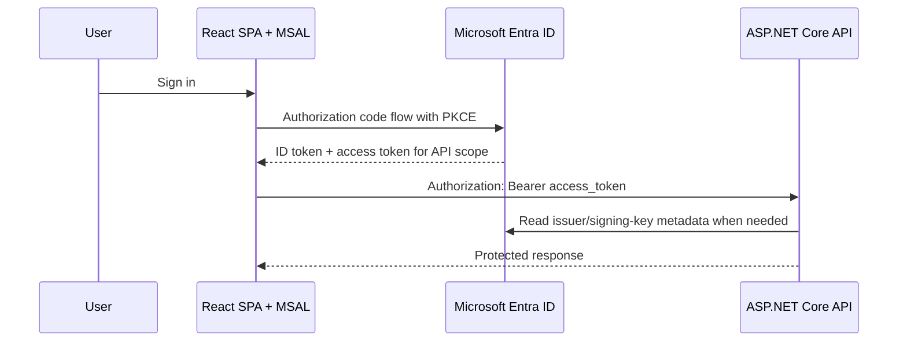

## Azure interview essentials (.NET, React, full stack & GenAI)

### Core platform and architecture
- **Region / availability zone:** A region is a geographic area; zones are isolated datacenters within a region for fault tolerance.
- **Resource hierarchy:** Resources are organized into resource groups, subscriptions, and management groups; scopes also determine governance and access.
- **Azure Resource Manager (ARM):** Azure's control plane for creating and managing resources through portal, CLI, SDKs, or templates.
- **Infrastructure as Code:** Bicep is Azure-native declarative IaC; Terraform is a common cross-cloud alternative. Version and review deployments.
- **Azure Policy / tags / locks:** Policy enforces configuration rules, tags support ownership and cost reporting, and locks guard against accidental changes or deletion.
- **Shared responsibility:** Microsoft manages cloud infrastructure; customers still secure identities, data, configurations, and applications.
- **Availability / scalability / elasticity:** Availability is uptime; scalability handles growth; elasticity adjusts capacity as demand changes.
- **SLA / SLO:** An SLA is a provider commitment; an SLO is your operational target. Architect for component failures regardless.
- **Well-Architected Framework:** Azure design guidance covering reliability, security, cost optimization, operational excellence, and performance efficiency.
- **Azure Monitor / Log Analytics:** Collects metrics and logs, supports alerts and dashboards; query logs with Kusto Query Language (KQL).
- **Application Insights:** Application performance monitoring for requests, dependencies, exceptions, distributed traces, and user behavior.

### Identity, security, networking, and data
- **Microsoft Entra ID (formerly Azure AD):** Identity platform for authentication, single sign-on, and application identities.
- **OAuth 2.0 / OpenID Connect:** OAuth handles delegated authorization; OIDC adds authentication. React public clients typically use authorization code with PKCE.
- **Managed identity:** Azure-managed Entra identity lets a workload access services without embedding credentials.
- **Azure RBAC:** Assigns roles to identities at a scope; follow least privilege and prefer narrow scopes.
- **Key Vault:** Stores secrets, keys, and certificates; access it with managed identity and rotate credentials as appropriate.
- **VNet / NSG:** A virtual network provides private connectivity; network security groups filter traffic with rules.
- **Private Link / Private Endpoint:** Connects privately to supported services using a VNet IP; configure DNS and restrict public access when required.
- **Front Door / Application Gateway:** Front Door offers global HTTP routing, acceleration, and edge WAF; Application Gateway offers regional layer-7 routing and WAF.
- **Azure Storage:** Blob is object storage; Files provides managed file shares; Queue and Table serve simpler messaging and NoSQL scenarios.
- **Azure SQL Database / Cosmos DB:** Managed relational SQL versus globally distributed NoSQL with multiple APIs and consistency choices.
- **Azure Cache for Redis:** In-memory cache that reduces latency and database load; it is not the system of record.
- **Service Bus:** Durable enterprise messaging with queues, topics/subscriptions, retries, and dead-letter queues.
- **Event Grid / Event Hubs:** Event Grid routes discrete events; Event Hubs ingests high-volume event streams and telemetry.
- **Message processing:** Delivery can be at-least-once; build idempotent consumers and plan retries, ordering, and dead-letter handling.

### Hosting, delivery, and operations
- **App Service:** Managed hosting for web apps and APIs; deployment slots enable staged releases and swaps.
- **Azure Functions:** Event-driven serverless compute; understand triggers, execution limits, cold starts, retries, and idempotency.
- **Container Apps / AKS:** Container Apps provides managed autoscaling containers; AKS provides managed Kubernetes for cluster-level control.
- **API Management (APIM):** API gateway for publishing, securing, throttling, transforming, versioning, and monitoring APIs.
- **Azure Static Web Apps:** Hosts static front ends with integrated deployments and optional API integration.
- **CI/CD:** GitHub Actions or Azure Pipelines can build, test, scan, and deploy; use approvals and federated identity rather than long-lived credentials.
- **Resilience patterns:** Use timeouts, bounded retries with backoff, circuit breakers, health checks, and graceful degradation.
- **Disaster recovery:** RTO is the recovery-time target; RPO is the tolerable data-loss window. Choose backups and replication accordingly.
- **Cost management:** Apply budgets, alerts, tags, autoscaling, right-sizing, and storage lifecycle policies.

### Azure AI and generative AI
- **Azure AI Foundry (formerly Azure AI Studio):** Platform for building, evaluating, deploying, and monitoring AI applications, models, and agents.
- **Model catalog:** Find and compare foundation and task-specific models; availability, terms, regions, and pricing differ by model.
- **Azure OpenAI Service:** Azure-hosted access to supported OpenAI models with Azure security and enterprise controls; availability varies by region.
- **Model deployment and quota:** A deployment exposes an inference endpoint and capacity; account for quotas, throughput, latency, and cost.
- **Tokens / context window:** Tokens measure model input and output; the context window limits their combined size.
- **Prompt engineering:** Provide clear instructions, relevant context, examples, and output constraints; validate responses instead of assuming correctness.
- **Embeddings:** Vector representations useful for semantic similarity and retrieval; index using compatible models and dimensions.
- **RAG:** Retrieval-augmented generation fetches relevant, authorized source material at query time to ground a model response; it does not retrain the model.
- **Azure AI Search:** Search service with keyword, vector, and hybrid retrieval, filters, and semantic ranking; often used as a RAG retrieval layer.
- **Vector / hybrid search:** Vector search finds semantic similarity; hybrid combines vectors and keywords for complementary recall and precision.
- **Ingestion and chunking:** Extract and normalize content, split it into useful chunks, and retain metadata; chunk strategy affects retrieval quality and cost.
- **Grounding and citations:** Include source references and citations for verification; enforce document permissions during retrieval, not just in the UI.
- **Agents and tools:** Agents select or invoke tools; validate arguments, constrain permissions, handle failures, and require approval for consequential actions.
- **Foundry Agent Service:** Managed capabilities for building agents with models and tools; verify current feature availability and integrations.
- **Content Safety:** Azure AI Content Safety can detect harmful content and prompt attacks; combine it with policy, access controls, and human review as needed.
- **Responsible AI:** Evaluate safety, fairness, privacy, transparency, and human oversight throughout development and operation.
- **Evaluation / observability:** Test groundedness, relevance, correctness, safety, latency, and cost; monitor traces and user feedback in production.
- **Prompt injection / data leakage:** Treat user and retrieved content as untrusted; separate instructions from data, limit tool privileges, and never put secrets in prompts.
- **Fine-tuning vs. RAG:** Fine-tuning adapts model behavior; RAG supplies current or private knowledge at inference time. They address different needs.
- **AI security:** Use Entra identities, least-privilege access, protected endpoints, and private networking where appropriate.
- **AI cost and throughput:** Track token, embedding, and search costs; manage rate limits, quotas, caching, and provisioned versus consumption capacity.

### Full-stack interview design points
- **React security:** A browser app is a public client; never ship secrets. Use OIDC/PKCE and enforce authorization in the .NET API.
- **.NET on Azure:** App Service or Container Apps are common hosting options; use managed identity, Key Vault, APIM, Application Insights, and fit-for-purpose data stores.
- **Async workflows:** Put slow or retryable work behind Service Bus or event services, process with Functions/containers, and return a job-status identifier to the UI.
- **Production readiness:** Be ready to discuss threat modeling, observability, rollback, data migrations, rate limiting, accessibility, reliability targets, and cost.

### React + .NET MSAL JWT authentication flow

Use **Microsoft Entra ID** to sign in users. React uses MSAL to obtain an **access token**. The .NET API validates that JWT access token before returning protected data.

#### 1. Entra ID setup

Create two app registrations in the same tenant:

| App registration | Configure |
|---|---|
| React SPA | Add a **Single-page application** redirect URI, such as `http://localhost:5173`. No client secret is used. |
| .NET API | Select **Expose an API**, set an Application ID URI such as `api://<api-client-id>`, and create a delegated scope named `access_as_user`. |

Then, in the React app registration, add the API's delegated `access_as_user` permission and grant consent when required.

#### 2. Request flow

- The **ID token** identifies the signed-in user to the React app.
- The **access token** is sent only to the API and contains an audience (`aud`) and delegated scopes (`scp`).
- The API must validate the access token. The React app must never decide authorization by itself.

#### 3. React responsibilities

- React is a **public client**. It uses MSAL and authorization code flow with PKCE; it has no client secret.
- When the user chooses Sign in, MSAL redirects them to Entra ID and returns them to the registered redirect URI.
- MSAL receives an ID token for the React app and requests an access token for the .NET API scope, such as `access_as_user`.
- Before calling the API, React asks MSAL for an access token silently. If user interaction is required, MSAL redirects the user to sign in or consent again.
- React sends the access token in the HTTP `Authorization: Bearer <token>` header.

#### 4. .NET API responsibilities

- The API uses JWT bearer authentication and Entra metadata to validate the token signature, issuer, tenant, expiry, and audience.
- The API then authorizes the request by checking a delegated scope (`scp`, for example `access_as_user`) or an application role (`roles`).
- A valid token proves who the caller is; a required scope or role proves what the caller can do.
- The API returns `401 Unauthorized` for a missing or invalid token, and `403 Forbidden` for a valid token without permission.
- Keep CORS restricted to known React origins. CORS is not authentication or authorization.

#### 5. Security rules to remember

- Use access tokens for APIs, not ID tokens.
- Never place client secrets, API keys, or tokens in React source code, browser storage, or logs.
- Request only the scopes the API needs, and enforce scopes or roles at every protected API endpoint.
- Use HTTPS and restrict both Entra redirect URIs and API CORS origins to known application URLs.
- When the API accesses Azure services, use managed identity and the service's RBAC. Do not use the user's access token as a replacement for application credentials.

#### Quick explanation

`React + MSAL` handles sign-in and gets an API access token. `Microsoft Entra ID` issues the token. `ASP.NET Core` validates the JWT and checks scope or role before serving protected data.

## Azure Quick-Reference Summary Table

| # | Topic | Essential recall |
|---|---|---|
| 1 | Region and availability zones | Region = geographic area; zones = isolated datacenters for fault tolerance |
| 2 | Resource hierarchy | Management group > subscription > resource group > resource |
| 3 | Azure Resource Manager | Control plane for creating and managing Azure resources |
| 4 | Infrastructure as Code | Bicep for Azure-native IaC; Terraform for multi-cloud IaC |
| 5 | Governance | Policy enforces rules; tags support ownership/cost; locks prevent accidental deletion |
| 6 | Shared responsibility | Azure secures cloud infrastructure; customer secures identities, data, configuration, and code |
| 7 | Availability and scale | Availability = uptime; scalability = handle growth; elasticity = adjust capacity automatically |
| 8 | SLA, SLO, Well-Architected | Provider commitment, application target, and guidance for reliability, security, cost, operations, performance |
| 9 | Monitor and Application Insights | Monitor collects metrics/logs; App Insights tracks requests, dependencies, exceptions, and traces |
| 10 | Microsoft Entra ID | Identity, authentication, SSO, users, groups, applications, and workload identities |
| 11 | OAuth 2.0 and OIDC | OAuth authorizes API access; OIDC signs users in and provides identity information |
| 12 | Managed identity and RBAC | Managed identity avoids stored credentials; RBAC gives least-privilege access at a scope |
| 13 | Key Vault | Store secrets, keys, and certificates; access with managed identity |
| 14 | VNet and NSG | VNet provides private networking; NSG filters inbound/outbound traffic |
| 15 | Private Endpoint | Private IP access to Azure PaaS services; requires correct private DNS setup |
| 16 | Front Door and Application Gateway | Front Door = global edge HTTP routing/WAF; App Gateway = regional layer-7 routing/WAF |
| 17 | Storage | Blob = objects; Files = file shares; Queue = simple messaging; Table = simple NoSQL |
| 18 | Azure SQL, Cosmos DB, Redis | SQL = relational; Cosmos = distributed NoSQL; Redis = cache, not system of record |
| 19 | Service Bus | Durable queues and topics, retries, dead-lettering, and enterprise messaging |
| 20 | Event Grid and Event Hubs | Event Grid routes discrete events; Event Hubs ingests high-volume streams |
| 21 | Message reliability | Expect at-least-once delivery; create idempotent consumers and handle retries/dead letters |
| 22 | App Service and deployment slots | Managed web/API hosting; slots enable staged deployment and swap |
| 23 | Azure Functions | Event-driven serverless compute; know triggers, retries, cold starts, and idempotency |
| 24 | Container Apps and AKS | Container Apps = managed autoscaling containers; AKS = Kubernetes control and flexibility |
| 25 | API Management | Publish, secure, throttle, transform, version, and monitor APIs |
| 26 | Static Web Apps and CI/CD | Host front ends; use GitHub Actions/Azure Pipelines with tests, scans, approvals, and federated identity |
| 27 | Resilience and disaster recovery | Use timeouts, backoff, circuit breakers, health checks; RTO = recovery time, RPO = allowed data loss |
| 28 | Cost management | Budgets, alerts, tags, autoscale, right-size resources, and lifecycle policies |
| 29 | Azure AI Foundry and Azure OpenAI | Build, deploy, evaluate, and monitor AI applications, models, and agents |
| 30 | Model deployment | Deployment exposes a model endpoint; plan quota, throughput, latency, and token cost |
| 31 | Tokens and prompting | Context window limits input/output tokens; prompts need clear instructions, context, examples, and constraints |
| 32 | Embeddings, RAG, and AI Search | Embeddings enable semantic similarity; RAG retrieves current knowledge; AI Search provides keyword/vector/hybrid retrieval |
| 33 | RAG ingestion and grounding | Chunk content, retain metadata/permissions, retrieve authorized sources, and return citations |
| 34 | Agents and AI safety | Constrain tools/permissions, validate arguments, protect against prompt injection, evaluate safety/relevance/cost |
| 35 | Fine-tuning versus RAG | Fine-tuning changes model behavior; RAG supplies current/private knowledge at runtime |
| 36 | React MSAL and JWT API flow | MSAL signs in with PKCE and gets an access token; .NET validates JWT and enforces scopes/roles |
| 37 | Full-stack production readiness | Discuss threat modeling, observability, rollback, migrations, rate limits, accessibility, reliability, and cost |
